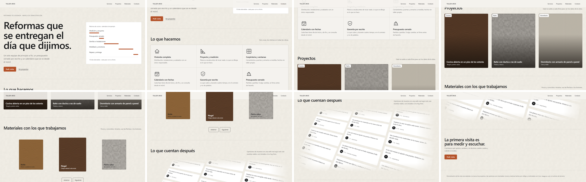
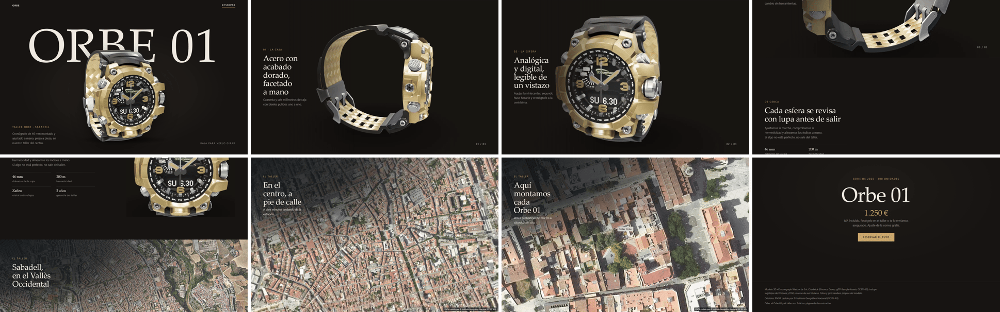
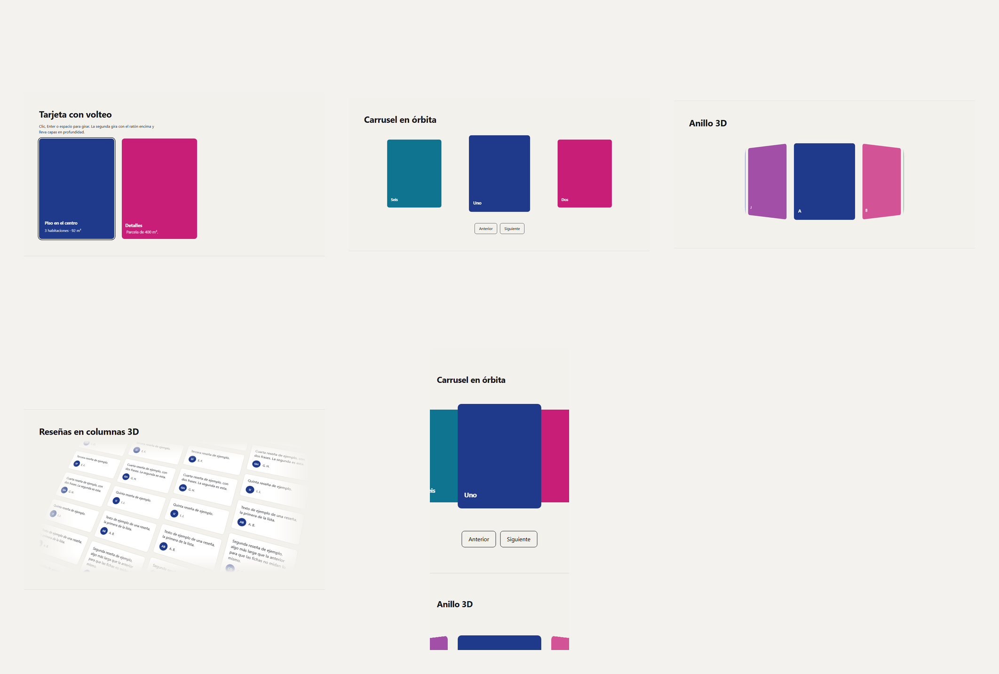
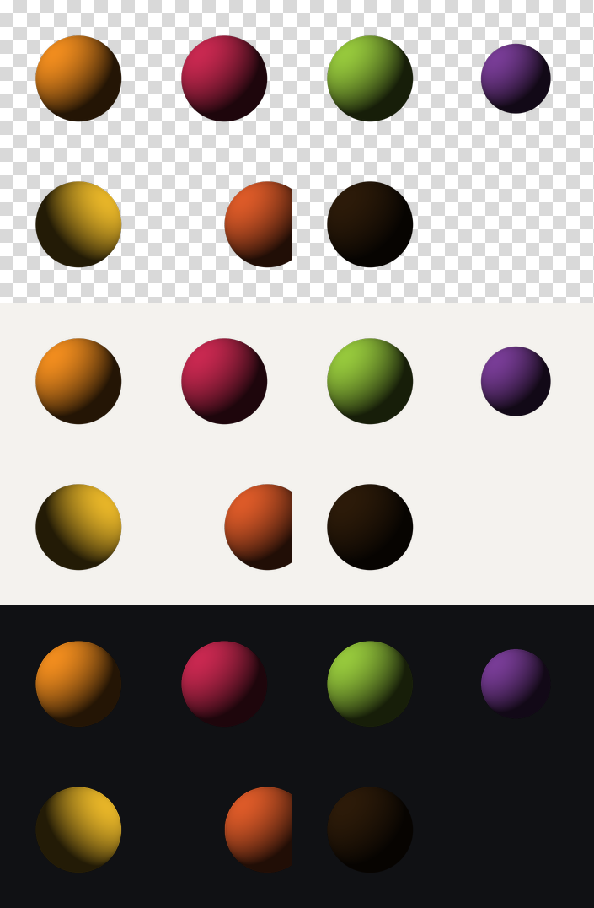

# the-new-era-websites · marketplace de Claude Code

**v1.0.0** · [Read in English](README.md) · antes `webs-premium` ([nota de migración](#migrar-desde-webs-premium))

Todo lo que vamos aprendiendo de hacer webs con Claude Code, en skills ordenadas **por técnica**: scroll cinematográfico con vídeo convertido en frames, capas con fondo transparente (el texto entre el producto y el fondo), imágenes que se revelan y transiciones, recursos de imagen con IA en lotes coherentes (objetos sueltos con alfa, juegos de iconos de marca, texturas repetibles, fondos de sección), componentes reutilizables (tarjeta con volteo, carrusel orbital, muro de reseñas 3D), un catálogo de componentes de interfaz para adaptar, 3D real como un módulo opcional más, lata que gira sin 3D, lente de rayos X y un mapa que baja hasta el edificio. Y las reglas aprendidas en webs entregadas.

Una skill maestra (**NEW ERA**) recoge el pedido, **elige una dirección de estilo para ese cliente** (diez direcciones bien distintas, de la cinematográfica a la corporativa, la editorial, la minimal o la juguetona, cada una con cómo ejecutarla a buen nivel), carga en cada fase las skills de diseño que tengas instaladas, busca la idea y la firma de la web, combina técnicas, planifica los activos con su coste, monta la web, la verifica con capturas y la hace revisar por rondas hasta que deja de parecer genérica.

**Lo realista sale de la IA, no del 3D, y no todo es vídeo.** Lo que está quieto es una foto (aislada, con alfa o en capas) que mueve el código; vídeo solo donde la cámara viaja o algo cambia físicamente. `pedir-assets-ia` decide el medio de cada elemento, estima el coste antes de generar, escribe los prompts para cualquier proveedor y revisa el resultado.

<p align="center"></p>

## Instalar
Requisitos:
- Claude Code reciente, con `/plugin`.
- Para los scripts: Node 20+ y ffmpeg en el PATH (o su ruta en las variables `FFMPEG` / `FFPROBE`).
- Para las webs que salen: npm. La verificación visual usa Chrome o Chromium con `playwright-core`.

**Desde GitHub:**
```
/plugin marketplace add FefeRP/the-new-era-websites
/plugin install the-new-era-websites@the-new-era-websites
```

**Desde una copia local:**
```
git clone https://github.com/FefeRP/the-new-era-websites.git
/plugin marketplace add ./the-new-era-websites
/plugin install the-new-era-websites@the-new-era-websites
```

Reinicia Claude Code (o `/reload-plugins`) y comprueba con `/plugin` que `the-new-era-websites` está activo. Desde la terminal vale lo mismo con `claude plugin marketplace add …` y `claude plugin install …`.

- **Actualizar:** `/plugin marketplace update the-new-era-websites`.
- **Probar sin instalar:** `claude --plugin-dir plugins/the-new-era-websites`.

## Usar
Escribe **NEW ERA: …** (o `/new-era …`) con el negocio, el producto y los activos que tienes. La skill maestra:
1. Hace el brief (también qué es verdad: reseñas, cifras).
2. Elige la **dirección de estilo** (estilo e intensidad) a partir del cliente, un tablero de referencias variadas y dos o tres opciones claramente distintas, y la deja escrita en `DESIGN.md`. Las skills de diseño se cargan con la herramienta Skill, no se recuerdan de memoria.
3. Busca la idea, el hilo conductor y la firma de la web: un momento estrella en las inmersivas, una firma más callada en las contenidas. Toda web lleva una.
4. Decide qué **módulos** activa (3D y WebGL, vídeo con IA, scroll inmersivo y frames, assets de IA, biblioteca de componentes, lugar y mapa), cada uno con su motivo en el brief, y elige las técnicas y los componentes y cómo se combinan. Una web que no lo necesita no arrastra 3D ni vídeo.
5. Planifica los activos con su coste y dos o tres opciones.
6. Monta la web con la plantilla (Vite + GSAP + Lenis) o dentro de tu proyecto, empezando por la primera pantalla y la firma. Antes de escribir o cambiar código que use la API de una librería (Next.js, React, Tailwind, GSAP, three.js…) consulta su documentación actual en la versión exacta del `package.json` con `find-docs`, y sigue Modern Web Guidance en las decisiones de plataforma (Core Web Vitals, imágenes, fuentes, accesibilidad, View Transitions, CSS moderno).
7. La verifica con capturas en escritorio, móvil y movimiento reducido, le pasa la «prueba del genérico», pide la crítica a la skill de diseño y una segunda mirada a un revisor independiente, y repite por rondas.
8. Entrega con la lista de skills que se cargaron de verdad, la documentación consultada, las rondas de revisión y el tiempo usado.

### Base común y módulos
NEW ERA sirve para cualquier web con carácter: corporativa, despacho, editorial, inmobiliaria, tienda, restaurante u hotel, producto o inmersiva.
- **Base común (siempre):** brief, dirección de estilo y `DESIGN.md`, idea, hilo y firma, estructura, tipografía, ritmo, movimiento por código (revelados, titulares por líneas, transiciones, componentes interactivos), skills de diseño cargadas en cada fase, código contra la documentación actual (`find-docs` y Modern Web Guidance), verificación con capturas y revisión por rondas.
- **Módulos (solo si el proyecto los pide):**

| Módulo | Se activa cuando… | Skills |
|---|---|---|
| 3D y WebGL | el visitante gira o configura el objeto, el objeto vuelve en varias secciones, la idea es abstracta (luz, partículas, fondo por shader), hay un modelo 3D o una escena de Spline | `escena-3d-gltf`, skills de WebGL, recetas de Spline |
| Vídeo con IA | la cámara viaja por un sitio, algo cambia físicamente, se cuenta un proceso (también «la obra al revés» con Seedance 2.5) | `video-ia-para-scroll`, `pedir-assets-ia`, `seguir-pantalla` |
| Scroll inmersivo y frames | la web es un recorrido que controla el scroll, con secuencias que avanzan y retroceden | `scroll-frames`, `video-desde-html`, GSAP ScrollTrigger |
| Assets de IA (foto, alfa y capas) | falta la imagen que la idea necesita, profundidad sin 3D, mirar dentro, envases con variantes | `pedir-assets-ia`, `recursos-imagen-ia`, `fotos-producto-ia`, `capas-alfa`, `parallax-capas`, `lente-revelado`, `envase-giratorio` |
| Biblioteca de componentes | hay piezas de interfaz que pueden existir en el catálogo y el catálogo está disponible | `biblioteca-componentes` |
| Lugar y mapa | la ubicación vende o hay que contar un viaje | `mapa-zoom-ubicacion` |

La maestra escribe en `BRIEF.md` qué módulos activa y por qué, y solo carga sus skills. Detalle y combinaciones por tipo de web: [modulos/README.md](plugins/the-new-era-websites/skills/new-era/references/modulos/README.md).

La palabra clave anterior, **WEB PREMIUM:**, y el comando `/web-premium` siguen funcionando como alias.

Ejemplo: `NEW ERA: landing para un reloj de edición limitada; tengo 4 fotos del producto y el logo; quiero que gire al hacer scroll`.

> Las skills nunca gastan en servicios de pago (Higgsfield, APIs de vídeo o imagen) sin dar antes un presupuesto y esperar tu sí.

## Skills
| Skill | Para qué |
|---|---|
| `new-era` | Maestra (palabra clave **NEW ERA**): dirige todo el proceso con una base común (dirección de estilo con diez direcciones y tres intensidades, qué skills de diseño se cargan en cada fase, revisión por rondas) y seis módulos opcionales que activa según el proyecto y deja escritos en el brief (3D y WebGL, vídeo con IA, scroll inmersivo, assets de IA, biblioteca, lugar y mapa); plantilla Vite + GSAP + Lenis; `nueva-web.mjs` (con `--modulos`) y `verificar-scroll.mjs`; reglas aprendidas en webs entregadas (dirección, carga, móvil, trampas de CSS, cómo se comprueba) |
| `recursos-imagen-ia` | Recursos de imagen con IA en lotes coherentes: objetos sueltos con alfa (frutas, hielo, hojas, piezas que flotan alrededor del producto), juegos de iconos de marca a partir de una sola lámina, texturas repetibles, fondos de sección con sitio para el titular (y su pareja día/noche), el mismo objeto en otros ángulos o materiales. Prompts por tipo de recurso y `lote-imagenes.mjs` para revisar el lote sin Python: hoja de conjunto sobre varios fondos, coherencia de luz y claridad entre piezas, corte de la lámina de iconos con medida del grosor del trazo, texturas medidas y arregladas para mosaico |
| `componentes-interactivos` | Componentes reutilizables sin dependencias y con la accesibilidad resuelta: `tarjeta-volteo.js` (tarjeta con volteo 3D y capas en profundidad), `carrusel-orbital.js` (carrusel circular en órbita, o anillo 3D que gira con arrastre, teclado, autoplay o el scroll) y `resenas-3d.js` (muro de reseñas en columnas 3D inclinadas en movimiento continuo). Cada uno con táctil, movimiento reducido y `destruir()` |
| `pedir-assets-ia` | Director de assets de IA: medio de cada elemento con una matriz de decisión (foto, foto con alfa o en capas, vídeo, vídeo con alfa, frames, código o 3D, con coste, peso y riesgo), coste antes de generar (`presupuesto.mjs`, la prueba más barata primero, tu presupuesto), plantillas de prompt por tipo de plano para Higgsfield, Kling, Veo, Seedance, Wan, Runway, Midjourney, Flux…, continuidad con imagen de inicio y fin, recetas por tipo de web y revisión "¿se nota falso?" (`revisar-ia.mjs` con Gemini + señales) |
| `scroll-frames` | Vídeo → frames WebP/AVIF (escritorio y móvil) → canvas ligado al scroll, cada frame nítido y sin mezclar; modo vídeo alternativo |
| `seguir-pantalla` | La web, el logo o un texto reales sobre una pantalla o cartel del vídeo IA: `seguir-pantalla.mjs` sigue sus 4 esquinas fotograma a fotograma (subpíxel, ida y vuelta) y `capa-pantalla.js` pega ahí una capa HTML con `matrix3d`, con su proporción (nunca estirada) |
| `video-ia-para-scroll` | Cómo pedir el vídeo a Higgsfield (Seedance, Kling, Veo, Wan…) para hacer scroll y revisarlo automáticamente. Una guía por modelo (parámetros reales, precios medidos, fallos conocidos, prompt de partida), una biblioteca de 13 plantillas de prompt por tipo de plano (intro hacia delante, revelado de logo, bucle, transición A→B, órbita de producto, despiece, líquido, FPV…), árbol de decisión, checklists de antes de generar y al recibir, flujos (imagen clave, encadenar, bucles, upscale, deflicker, logos sin deformar) y la receta de montaje en la web medida en Chrome (GOP, códecs, frames, móvil, póster, movimiento reducido); estimaciones gratis con `estimar-higgsfield.mjs`; la revisión mide cortes, saltos disimulados y el avance real de la cámara; receta "producto por dentro" |
| `fotos-producto-ia` | Fotos del producto real en otras escenas con IA: referencias, prompts por encuadre y luz, consistencia entre tomas, capas, detección y arreglo de deformaciones, precios |
| `capas-alfa` | Elementos con fondo transparente sin Python ni GPU: cómo pedir a la IA el elemento aislado; `alfa.mjs` lo recorta de un color liso, negro, blanco o una pareja negro/blanco (alfa exacto en cristal y líquidos) y saca MP4 con alfa apilado (todos los navegadores, lo reproduce `video-alfa.js` en WebGL), WebM VP9, frames WebP con alfa para el scroll, PNG y una hoja de revisión con métricas; composición de capas con el texto en medio |
| `revelados-y-transiciones` | `revelados.js`: imagen que se descubre en rejilla, cortina que cambia de escena, zoom 2D a un punto de una imagen grande con relevo a una foto de detalle, titular que sube por líneas; tarjeta a pantalla completa, View Transitions, animaciones CSS ligadas al scroll |
| `rastro-cursor` | Fotos que siguen al cursor y se desvanecen (grupo fijo de imágenes, solo ratón; composición estática en táctil y con movimiento reducido) |
| `video-desde-html` | Vídeo a partir de HTML, CSS y JS con [HyperFrames](https://github.com/heygen-com/hyperframes) (open source), sin modelos de IA de vídeo: el hero, un tramo de scroll o el producto girando pasan a MP4 9:16 o 16:9 para promos y redes; y en el otro sentido, fondos en bucle sin corte, capas con transparencia y secuencias para scroll hechas por código. Lanzador seguro `hf.mjs` (versión fijada, sin telemetría ni descargas), plantillas probadas, `medir-bucle.mjs` y tiempos de render medidos |
| `biblioteca-componentes` | Buscar, elegir y adaptar componentes de interfaz de un catálogo propio (índice JSON con código, dependencias, demo, licencia, autor y un prompt de integración por componente, sincronizado desde registros abiertos tipo shadcn como Magic UI, SmoothUI, Origin UI, Cult UI, Motion Primitives o Animata). `buscar.mjs` (sin dependencias) busca en español o en inglés y saca código y prompt; una tabla de cambios para que ningún componente salga tal cual; reglas de licencia (MIT, «no redistribuir», de pago); recetas de Spline (hero con escena y póster, objeto que sigue al ratón, escena movida por el scroll, eventos y variables desde React, carga diferida). El catálogo no viaja con el plugin: `BIBLIOTECA_COMPONENTES` apunta al tuyo |
| `parallax-capas` | Profundidad 2.5D: capas con scroll y puntero, CSS scroll-driven; `capas-sombra.mjs` saca la sombra como capa semitransparente (producto que levita, cambio de fondo) |
| `escena-3d-gltf` | three.js con glTF optimizado (meshopt), entorno PBR, arrastre y scroll, rendimiento móvil, cancelación de carga |
| `lente-revelado` | Lente que sigue al cursor (o al dedo) y enseña otra versión alineada: rayos X, térmica, interior; interruptor de modos; cortina antes/después con el scroll; `variantes-revelado.mjs` saca rayos X y térmica de una foto con ffmpeg y comprueba la alineación |
| `envase-giratorio` | Lata, bote o tarro que gira sin 3D: etiqueta plana enrollada en canvas con sombreado y tapa; giro con scroll, arrastre o slider de sabores (fondo, título y frutas que cambian a la vez) |
| `mapa-zoom-ubicacion` | Del mapa al edificio: MapLibre con ortofoto real (PNOA en España, gratis) y edificios 3D de OSM; cámara por paradas ligada al scroll, edificio resaltado, relevo a la foto; fuentes de mapa con licencias y precios. Segundo camino, `mapa-imagen.js`: niveles de imagen anidados (ortofoto real, o estilizada con IA sobre ella sin inventar geografía), cámara anclada, viaje de un sitio a otro, marcadores y rutas por código, fotogramas exactos de inicio y fin para pedir un clip IA entre dos vistas |

## Reparto con las skills de diseño
Este marketplace cubre **técnica y activos**. No es un sistema de diseño ni una guía de tipografía, color o microinteracciones: la maestra carga en cada fase (dirección, componentes, movimiento, revisión) las skills de diseño que tengas instaladas en vez de repetir sus instrucciones, y dice en el informe cuáles cargó. Ninguna hace falta para que funcione, pero el resultado es claramente mejor con ellas; lo que nunca se delega es la dirección de estilo, la idea de la web y la comprobación de que no parece genérica.

| Tema | Quién manda | Qué aporta este marketplace |
|---|---|---|
| Dirección visual (que no parezca plantilla) | `frontend-design`, `impeccable` (shape) | El momento estrella y la técnica que lo hace posible |
| Sistema de diseño, tokens, tipografía, color, maquetación, textos de interfaz | `impeccable` (typeset, colorize, layout, clarify; PRODUCT.md / DESIGN.md), con `ui-ux-pro-max` como fuente de datos (estilos, paletas, pares de fuentes) | Solo los tokens de la plantilla, que se rellenan con lo que decida el sistema |
| Microinteracciones (botones, menús, modales, hover) | `animate`, `emil-design-eng`, `apple-design` | Nada: los componentes de aquí traen su movimiento; un botón se anima con `animate` |
| Movimiento ligado al scroll, frames de vídeo, capas, revelados, mapas | **Este marketplace** | Motores, plantilla (Lenis + ScrollTrigger en un solo bucle) y verificación por posiciones; `gsap-skills` para la API |
| Activos de IA (imagen y vídeo), alfa, sombras | **Este marketplace** | Medio por elemento, presupuesto, prompts, revisión del lote |
| Componentes (tarjeta con volteo, carrusel orbital, reseñas 3D) | **Este marketplace** | Motores, accesibilidad y pruebas; el pulido, con `emil-design-eng` |
| Vídeo de la propia web para redes, bucles y capas por código | **Este marketplace** (`video-desde-html`, con HyperFrames) | Lanzador seguro, plantillas y medidas. La pieza editada con voz y subtítulos se queda en Remotion si el proyecto ya lo usa; el contrato completo, en las skills oficiales de HyperFrames si están instaladas |
| 3D de producto, shaders, partículas | **Este marketplace** en la escena de producto con glTF; `webgl-animation-skills` en shaders y partículas | Cuándo compensa el 3D y cuándo es mejor un vídeo |
| Detalles táctiles y de móvil | `mobile-native` | El encuadre vertical del momento estrella y los pesos por dispositivo |
| API de librerías y frameworks (Next.js, React, Tailwind, GSAP, three.js, Prisma…) | [`find-docs`](https://github.com/upstash/context7) (CLI de Context7, documentación de la versión del `package.json`) | Motores ya probados; la documentación manda sobre la memoria al escribir código propio |
| Plataforma web: Core Web Vitals, imágenes, fuentes, accesibilidad nativa, View Transitions, animación ligada al scroll en CSS, diálogos, formularios, PWA | [Modern Web Guidance](https://github.com/GoogleChrome/modern-web-guidance) (oficial, de Chrome) | Presupuestos de peso y la decisión motor contra nativo en las escenas |
| Accesibilidad, casos límite y crítica final | `impeccable` (audit, harden, critique, polish), `break-ui` | Movimiento reducido en todos los motores, texto real en el DOM y `verificar-scroll.mjs` antes de cualquier crítica |

Si dos skills dicen cosas distintas: una sola fuente de tokens, un solo sistema de scroll por página y la accesibilidad gana al efecto. Tabla completa y orden de trabajo: [reparto-skills-diseno.md](plugins/the-new-era-websites/skills/new-era/references/reparto-skills-diseno.md).

## Capturas
Web de demostración hecha con la skill maestra (`demos/reloj`, marca ficticia «Orbe»):


Una web de servicio sobria, sin momento estrella (`demos/estudio`, marca inventada «Taller Arce»): iconos de marca cortados de una sola lámina, texturas medidas y arregladas para mosaico, fichas con volteo, carrusel en órbita y muro de opiniones; sin secciones fijadas, sin vídeo y sin 3D:


Del mapa al edificio (`demos/mapa`, ubicación de ejemplo en Barcelona; datos de mapa © colaboradores de OpenStreetMap, ortofoto PNOA © IGN):


Ejemplo de extremo a extremo (`pruebas/extremo-a-extremo`): reloj recortado con el titular detrás, giro, revelado en rejilla y mapa hasta el taller:


Componentes (`pruebas/componentes`): tarjetas con volteo y capas, carrusel en órbita, anillo 3D y muro de reseñas:


Revisión de un lote de imagen (`pruebas/recursos-imagen`): la hoja de conjunto que hace `lote-imagenes.mjs` para juzgar juntas las piezas sueltas (entradas de prueba dibujadas por código):


## Qué hay en el repo
- `.claude-plugin/marketplace.json` → `plugins/the-new-era-websites/` (el plugin: `plugin.json`, `commands/`, `skills/`).
- `demos/reloj/`: web de demostración hecha con la skill maestra. Para verla: `cd demos/reloj && npm install && npm run dev` y abrir http://127.0.0.1:5190.
- `demos/estudio/`: web de servicio sin momento estrella (componentes, iconos de marca y texturas controlados con `lote-imagenes.mjs`). `cd demos/estudio && npm install && npm run dev` y abrir http://127.0.0.1:5192.
- `demos/mapa/`: del mapa al edificio (Barcelona, ubicación de ejemplo). `cd demos/mapa && npm install && npm run dev` (necesita internet: las teselas se piden en directo).
- `docs/referencias/`: análisis escritos de 16 webs y vídeos de referencia. Los vídeos no se incluyen porque son de sus autores.
- `docs/investigacion/`: ecosistema, marketplaces, vídeo IA y la investigación de 2026 sobre webs de scroll hechas con assets de IA (con fuentes y fechas).
- `pruebas/`: validación de los scripts con resultado conocido, cada una con su `LEEME.md` (se sirve la raíz del repo con `node pruebas/servidor-estatico.mjs . 5193`): `capas-alfa/` (alfa contra una verdad conocida), `revelados-rastro/`, `mapa-imagen/` (ortofoto PNOA real de Barcelona), `seguir-pantalla/`, `lente-envase/`, `capas-sombra/`, `componentes/` (42 comprobaciones en Chrome), `recursos-imagen/` (23 comprobaciones contra entradas conocidas), `clips-ia/` (banco para juzgar clips de IA para scroll: frames, costuras, notas) y `extremo-a-extremo/`: un ejemplo completo sin generar nada de pago (plan y presupuesto según la matriz de decisión, reloj recortado con el titular detrás, giro con el scroll, revelado en rejilla y mapa por niveles hasta el taller).
- `capturas/`: hojas de capturas de la verificación.

## Estado
**Probado:**
- Validación estricta del marketplace y del plugin.
- Instalación desde cero.
- Demos (reloj, mapa y web de servicio) verificadas sin errores en escritorio, móvil y movimiento reducido (Chrome con WebGL por software).
- `capas-sombra` medido contra una verdad renderizada.
- Seguimiento de pantalla medido contra la verdad (error medio ~1 px, máximo < 3 px) y la capa comprobada en Chrome en escritorio y móvil; presupuesto y revisión con Gemini probados sobre vídeo generado con IA real.
- Motores probados en Chrome: cancelación de carga y reintento de frames; lata que gira, lente y cortina con prueba de interacción (cursor, clic, dedo).
- `alfa.mjs` medido con entradas de alfa conocido (croma 39,8 dB, pareja negro/blanco 59,4 dB) y la página de capas comprobada por píxeles; revelados, rastro del cursor y mapa por niveles comprobados por píxeles en escritorio, móvil y movimiento reducido.
- Los tres componentes probados en Chrome (teclado, táctil, movimiento reducido, píxeles) y `lote-imagenes.mjs` contra entradas con defectos conocidos.

**Sin probar:**
- Una generación de pago nueva siguiendo las plantillas de prompt nuevas (Higgsfield u otros) y las recetas de imagen de `recursos-imagen-ia`, incluidos los modelos de imagen con alfa nativo y las APIs de recorte de vídeo.
- rembg, IC-Light y modelos de edición locales (necesitan Python o GPU; para recortar, `alfa.mjs` no los necesita).
- Vídeo HEVC con alfa (solo se codifica en un Mac).
- Mapa: relevo a foto real del edificio (la demo no tiene foto propia; el patrón está documentado) y fuentes de pago (MapTiler, Esri…).

**Previsto para la 1.1:**
- Una web real construida de principio a fin con NEW ERA.
- Las plantillas de prompt de vídeo validadas con clips reales.
- El vídeo y los frames medidos en móviles reales.
- Menos repeticiones entre la maestra, los módulos y las skills.
- Los componentes del catálogo sin vista previa, recuperados.

Cambios: ver [CHANGELOG.md](CHANGELOG.md).

## Migrar desde webs-premium
Hasta la 1.0.0-beta.5 este marketplace y su plugin se llamaban `webs-premium` / `web-premium`. Desde la 1.0.0-beta.6:

| Antes | Ahora |
|---|---|
| Marketplace `webs-premium`, plugin `web-premium` | Los dos, `the-new-era-websites` |
| Skill maestra `web-premium` | `new-era` |
| Palabra clave `WEB PREMIUM:`, comando `/web-premium` | `NEW ERA:`, `/new-era` (los anteriores siguen funcionando) |
| Carpeta `plugins/web-premium` | `plugins/the-new-era-websites` |

Si lo tenías instalado, quita el anterior y añade el nuevo:
```
/plugin uninstall web-premium@webs-premium
/plugin marketplace remove webs-premium
/plugin marketplace add FefeRP/the-new-era-websites
/plugin install the-new-era-websites@the-new-era-websites
```
Las demás skills conservan su nombre; ahora se invocan como `the-new-era-websites:<skill>`.

## Licencia y créditos
Código y textos: [MIT](LICENSE). Material de terceros (modelo 3D CC-BY de la demo, datos de mapa de OSM/OpenFreeMap/IGN, ideas adaptadas de `nateherkai/scroll-craft`): ver [CREDITOS.md](CREDITOS.md).
