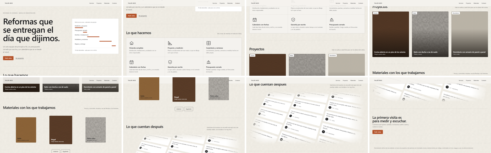
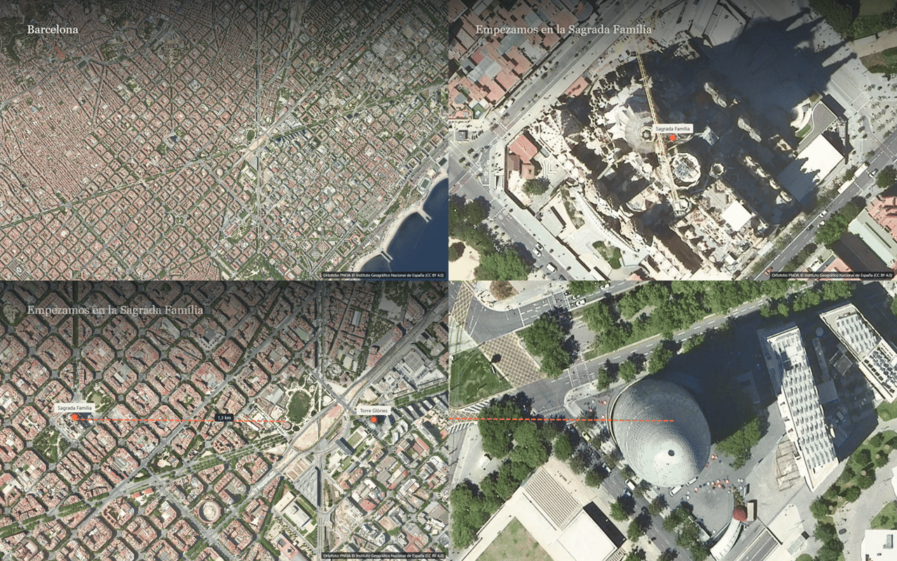
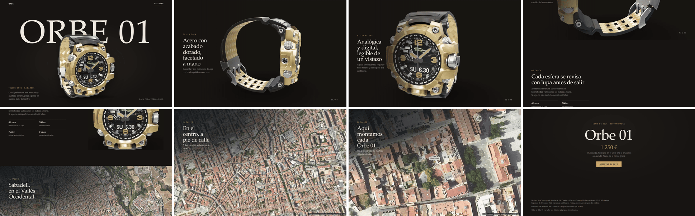
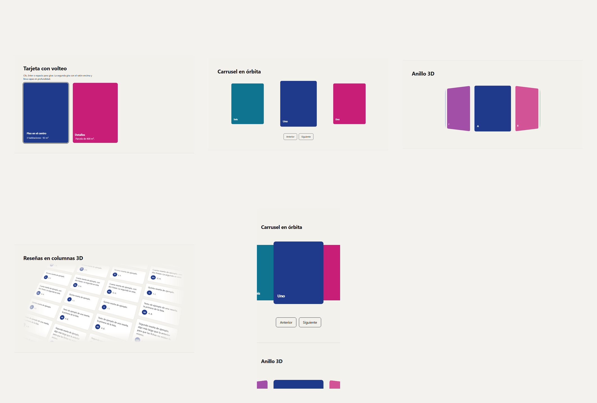
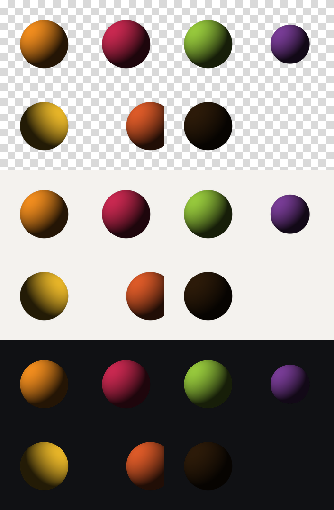

# the-new-era-websites · Claude Code marketplace

**v1.0.0** · [Leer en español](README.es.md) · formerly `webs-premium` ([migration note](#migrating-from-webs-premium))

Everything we learn about building websites with Claude Code, as skills organised **by technique**: cinematic scroll driven by video frames, transparent layers (text between the product and the background), image reveals and transitions, AI image assets in coherent batches (isolated objects with alpha, brand icon sets, seamless textures, section backgrounds), reusable components (3D flip card, orbital carousel, 3D testimonial wall), a catalogue of UI components to adapt, real 3D (glTF) as one optional module among others, a can that spins without 3D, an X-ray lens, and a map that flies down to a building. Plus the rules learned on delivered sites.

A master skill (**NEW ERA**) takes your brief, **chooses a style direction for that client** (ten distinct directions, from cinematic to corporate, editorial, minimal or playful, each with how to execute it at a high level), loads the design skills you have installed at every phase, finds the idea and the signature of the site, chooses and combines techniques, plans the assets with their cost, builds the site, verifies it with screenshots and has it reviewed in rounds until it no longer looks generic.

**Realism comes from AI imagery, not from 3D, and not everything is video.** What stands still is a photo (isolated, with alpha or in layers) that the code moves; video only where the camera travels or something physically changes. `pedir-assets-ia` decides the medium of every element, estimates the cost before generating anything, writes the prompts for any provider and reviews the result.

<p align="center"></p>

> The skills are written in **Spanish** (their trigger descriptions are in Spanish and English). Claude reads them fine whatever language you write in.

## Install
Requirements:
- A recent Claude Code with `/plugin`.
- For the scripts: **Node 20+** and **ffmpeg** in the PATH (or its path in the `FFMPEG` / `FFPROBE` environment variables).
- For the generated websites: npm. Visual verification uses Chrome/Chromium through `playwright-core`.

In Claude Code:
```
/plugin marketplace add FefeRP/the-new-era-websites
/plugin install the-new-era-websites@the-new-era-websites
```
Restart Claude Code (or `/reload-plugins`) and check with `/plugin` that `the-new-era-websites` is enabled.

From the terminal it works the same way:
```
claude plugin marketplace add FefeRP/the-new-era-websites
claude plugin install the-new-era-websites@the-new-era-websites
```

- **Update:** `/plugin marketplace update the-new-era-websites`.
- **Try it without installing:** `git clone https://github.com/FefeRP/the-new-era-websites.git` and `claude --plugin-dir the-new-era-websites/plugins/the-new-era-websites`.
- **From a local copy:** `/plugin marketplace add ./the-new-era-websites` and the same `/plugin install` line.

## Use
Start your request with the keyword **`NEW ERA:`** (or run `/new-era …`) and describe the business, the product and the assets you have:

```
NEW ERA: landing page for a limited-edition watch; I have 4 product photos and the logo; I want it to turn as you scroll
```

The master skill then:
1. Writes the brief (including what is actually true: reviews, figures).
2. Chooses the **style direction** (style and intensity) from the client, a board of varied references and two or three clearly different options, and writes it down in `DESIGN.md`. The design skills are loaded with the Skill tool, not recalled from memory.
3. Finds the idea, the thread that runs through the site and its signature: a star moment on immersive sites, a quieter signature on restrained ones. Every site gets one.
4. Decides which **modules** to switch on (3D and WebGL, AI video, immersive scroll and frames, AI assets, component library, place and map), each with its reason in the brief, and chooses the techniques and components and how they combine. A site that does not need them carries no 3D or video.
5. Plans the assets, with an estimated cost and two or three options.
6. Builds the site from its template (Vite + GSAP + Lenis), or inside your existing project, first screen and signature first. Before writing or changing code that uses a library API (Next.js, React, Tailwind, GSAP, three.js…) it checks the current docs for the exact version in `package.json` with `find-docs`, and it follows Modern Web Guidance for web platform decisions (Core Web Vitals, images, fonts, accessibility, View Transitions, modern CSS).
7. Verifies it with screenshots on desktop, mobile and reduced motion, runs the "generic test", asks the design skill for a critique and an independent reviewer for a second look, and repeats in rounds.
8. Delivers with the list of skills that were actually loaded, the documentation consulted, the review rounds and the time used.

### Common base and modules
NEW ERA works for any site with character: corporate, professional firm, editorial, real estate, shop, restaurant or hotel, product or immersive.
- **Common base (always):** brief, style direction and `DESIGN.md`, idea, thread and signature, structure, typography, rhythm, motion in code (reveals, line-by-line headlines, transitions, interactive components), design skills loaded at every phase, code checked against current docs (`find-docs` and Modern Web Guidance), screenshot verification and review in rounds.
- **Modules (only when the project asks for them):**

| Module | Switched on when… | Skills |
|---|---|---|
| 3D and WebGL | the visitor turns or configures the object, the object comes back across sections, the idea is abstract (light, particles, shader background), there is a 3D model or a Spline scene | `escena-3d-gltf`, WebGL skills, Spline recipes |
| AI video | the camera travels through a place, something physically changes, a process is told (including "the build in reverse" with Seedance 2.5) | `video-ia-para-scroll`, `pedir-assets-ia`, `seguir-pantalla` |
| Immersive scroll and frames | the site is a journey driven by the scroll, with sequences that play forwards and backwards | `scroll-frames`, `video-desde-html`, GSAP ScrollTrigger |
| AI assets (photo, alpha and layers) | the image the idea needs does not exist yet, depth without 3D, looking inside, packaging with variants | `pedir-assets-ia`, `recursos-imagen-ia`, `fotos-producto-ia`, `capas-alfa`, `parallax-capas`, `lente-revelado`, `envase-giratorio` |
| Component library | there are interface pieces that may exist in the catalogue and the catalogue is available | `biblioteca-componentes` |
| Place and map | the location sells, or a journey has to be told | `mapa-zoom-ubicacion` |

The master skill writes in `BRIEF.md` which modules it switches on and why, and only loads their skills. Details and combinations by type of site: [modulos/README.md](plugins/the-new-era-websites/skills/new-era/references/modulos/README.md) (in Spanish).

The old keyword **`WEB PREMIUM:`** and the `/web-premium` command still work as aliases.

> **No spending without asking.** The skills never use paid services (Higgsfield, image or video APIs) without first giving you an estimated price and waiting for your yes. Everything in this repo was made with free tools or code.

## Skills
| Skill | What it does |
|---|---|
| `new-era` | Master skill (keyword **NEW ERA**): directs the whole process with a common base (style direction with ten directions and three intensities, which design skills are loaded at each phase, review in rounds) and six optional modules it switches on per project and writes down in the brief (3D and WebGL, AI video, immersive scroll, AI assets, component library, place and map); Vite + GSAP + Lenis template; `nueva-web.mjs` (scaffold, with `--modulos`) and `verificar-scroll.mjs` (screenshots at each scroll step); rules learned on delivered sites (direction, loading, mobile, CSS traps, how to check) |
| `recursos-imagen-ia` | AI image assets as coherent batches: isolated objects with alpha (fruit, ice, leaves, pieces that float around the product), brand icon sets from a single sheet, seamless textures, section backgrounds with room for the headline (and their day/night pair), the same object in other angles or materials. Prompts per asset type and `lote-imagenes.mjs` to review the batch without Python: contact sheet over several backgrounds, light and brightness coherence between pieces, icon sheet cut with stroke-weight measurement, textures measured and fixed for tiling |
| `componentes-interactivos` | Reusable components with no dependencies and accessibility solved: `tarjeta-volteo.js` (3D flip card with depth layers), `carrusel-orbital.js` (circular carousel in orbit, or a 3D ring driven by drag, keyboard, autoplay or the scroll) and `resenas-3d.js` (testimonial wall in tilted 3D columns in continuous motion). Each with touch, reduced-motion and `destruir()` |
| `pedir-assets-ia` | AI asset director: per-element medium from a decision matrix (photo, photo with alpha or layers, video, video with alpha, frames, code or 3D, with cost, weight and risk), cost estimate before generating (`presupuesto.mjs`, cheapest test first, your budget), prompt templates per shot type for Higgsfield, Kling, Veo, Seedance, Wan, Runway, Midjourney, Flux…, start/end frame continuity, recipes per type of site, and a "does it look fake?" review (`revisar-ia.mjs` with Gemini + checklist) |
| `scroll-frames` | Video → WebP/AVIF frames (desktop and mobile) → canvas tied to the scroll (Apple-style scrubbing), every frame sharp and never blended; video mode alternative; data HUD tied to progress |
| `seguir-pantalla` | The real website, logo or text on a screen or sign inside the AI video: `seguir-pantalla.mjs` tracks its 4 corners frame by frame (sub-pixel, forward/backward) and `capa-pantalla.js` pins an HTML layer there with `matrix3d`, keeping its aspect ratio (never stretched) |
| `video-ia-para-scroll` | How to ask Higgsfield (Seedance, Kling, Veo, Wan…) for a video made for scrolling and review it automatically. One guide per model (real parameters, measured prices, known failures, starting prompt), a library of 13 prompt templates by shot type (forward intro, logo reveal, loop, A→B transition, product orbit, exploded view, liquid, FPV…), a decision tree, checklists before generating and after receiving, workflows (key image, chaining, loops, upscale, deflicker, keeping logos intact) and the web delivery recipe measured in Chrome (GOP, codecs, frames, mobile, poster, reduced motion); free cost estimates with `estimar-higgsfield.mjs`; the checker measures cuts, hidden jumps and real camera travel; "product from the inside" recipe |
| `fotos-producto-ia` | AI product photos that keep the real product: reference photos, prompts per shot and light, consistency, layers, detecting and fixing deformations, prices |
| `capas-alfa` | Transparent elements without Python or a GPU: how to ask the AI for an isolated asset; `alfa.mjs` keys it from a flat colour, black, white or a black/white pair (exact alpha for glass and liquids) and outputs stacked-alpha MP4 (all browsers, played by `video-alfa.js` in WebGL), VP9 WebM, alpha WebP frames for scroll, PNG and a review sheet with metrics; composing layers with text in between |
| `revelados-y-transiciones` | `revelados.js`: image revealed by a grid, curtain that swaps the scene, 2D zoom into one point of a large image with a hand-off to a detail image, headline rising line by line; card to full screen, View Transitions, CSS scroll-driven animations |
| `rastro-cursor` | Photos that trail the cursor and fade out (fixed pool of images, mouse only; static layout on touch and reduced motion) |
| `video-desde-html` | Video from HTML, CSS and JS with [HyperFrames](https://github.com/heygen-com/hyperframes) (open source), no AI video models: the hero, a scroll section or the spinning product become 9:16 or 16:9 MP4 for promos and social; and the other way round, seamless loop backgrounds, transparent layers and scroll sequences made in code. Safe launcher `hf.mjs` (pinned version, no telemetry, no downloads), tested templates, `medir-bucle.mjs` and measured render times |
| `biblioteca-componentes` | Search, choose and adapt UI components from your own catalogue (a JSON index with code, dependencies, demo, licence, author and an integration prompt per component, synced from open shadcn-style registries such as Magic UI, SmoothUI, Origin UI, Cult UI, Motion Primitives or Animata). `buscar.mjs` (no dependencies) searches in Spanish or English and prints code and prompt; a change table makes sure no component ships as-is; licence rules (MIT vs "no redistribution" vs paid); Spline recipes (scene hero with poster, object that follows the mouse, scroll-driven scene, events and variables from React, lazy loading). The catalogue itself is not shipped: point `BIBLIOTECA_COMPONENTES` at yours |
| `parallax-capas` | 2.5D depth: layers moving with scroll and pointer, CSS scroll-driven; `capas-sombra.mjs` extracts the shadow as its own semi-transparent layer (floating product, background swap) |
| `escena-3d-gltf` | three.js with an optimised glTF (meshopt), PBR environment, drag and scroll, mobile performance, cancellable loading |
| `lente-revelado` | A lens that follows the cursor (or finger) and reveals an aligned version of the image: X-ray, thermal, interior; mode switch; before/after curtain on scroll; `variantes-revelado.mjs` makes X-ray and thermal versions with ffmpeg and checks alignment |
| `envase-giratorio` | A can, jar or bottle that spins without 3D: the flat label is wrapped onto a cylinder in a 2D canvas with shading and lid; spin on scroll, drag or a flavour slider (background, title and fruit change together) |
| `mapa-zoom-ubicacion` | From the map to the building: MapLibre with real orthophoto (PNOA in Spain, free) and OSM 3D buildings; camera stops tied to the scroll, highlighted building; map sources with licences and prices. Second path, `mapa-imagen.js`: nested image levels (real orthophoto, or AI-stylised over it without inventing geography), anchored camera, moving from one place to another, markers and routes in code, exact start/end frames to ask for an AI clip between two views |

## Working with design skills
This marketplace covers **technique and assets**. It is not a design system or a typography, colour or micro-interaction guide: the master skill loads the design skills you have installed at each phase (direction, components, motion, review) instead of repeating their instructions, and reports which ones it loaded. None of them is required to run it, but the result is clearly better with them; what is never delegated is the style direction, the idea of the site and the check that it does not look generic.

| Topic | Who leads | This marketplace adds |
|---|---|---|
| Visual direction (not looking like a template) | `frontend-design`, `impeccable` (shape) | The star moment and the technique that makes it possible |
| Design system, tokens, typography, colour, layout, UI copy | `impeccable` (typeset, colorize, layout, clarify; PRODUCT.md / DESIGN.md), with `ui-ux-pro-max` as the data source (styles, palettes, font pairs) | Only the template tokens, filled with whatever the design system decides |
| Micro-interactions (buttons, menus, modals, hover) | `animate`, `emil-design-eng`, `apple-design` | Nothing: components here bring their own motion, a button is animated with `animate` |
| Scroll-linked motion, video frames, layers, reveals, maps | **This marketplace** | Engines, template (Lenis + ScrollTrigger in one loop), verification per scroll position; `gsap-skills` for the API |
| AI assets (image and video), alpha, shadows | **This marketplace** | Medium per element, budget, prompts, batch review |
| Components (flip card, orbital carousel, 3D testimonials) | **This marketplace** | Engines, accessibility and tests; polish with `emil-design-eng` |
| Video of the site itself for social, loops and layers made in code | **This marketplace** (`video-desde-html`, with HyperFrames) | Safe launcher, templates and measurements. An edited piece with voice and subtitles stays in Remotion if the project already uses it; the full contract lives in the official HyperFrames skills if installed |
| Product 3D, shaders, particles | **This marketplace** for glTF product scenes; `webgl-animation-skills` for shaders and particles | When 3D pays off and when a video is better |
| Touch and mobile details | `mobile-native` | The vertical framing of the star moment and weights per device |
| Library and framework APIs (Next.js, React, Tailwind, GSAP, three.js, Prisma…) | [`find-docs`](https://github.com/upstash/context7) (Context7 CLI, docs for the version in `package.json`) | Engines already tested; the docs win over memory when writing your own code |
| Web platform: Core Web Vitals, images, fonts, native accessibility, View Transitions, scroll-driven CSS, dialogs, forms, PWA | [Modern Web Guidance](https://github.com/GoogleChrome/modern-web-guidance) (official, from Chrome) | Weight budgets and the engine-vs-native decision for scenes |
| Accessibility, edge cases, final critique | `impeccable` (audit, harden, critique, polish), `break-ui` | reduced-motion in every engine, real text in the DOM, `verificar-scroll.mjs` before any critique |

Rules when two skills disagree: one source of tokens, one scroll system per page, accessibility wins over effect. Full table and order of work: [reparto-skills-diseno.md](plugins/the-new-era-websites/skills/new-era/references/reparto-skills-diseno.md) (in Spanish).

## Screenshots
Demo site built with the master skill (`demos/reloj`, fictional brand "Orbe"):


A sober service site with no star moment (`demos/estudio`, invented brand "Taller Arce"): brand icons cut from a single sheet, textures measured and fixed for tiling, flip cards, orbital carousel and testimonial wall; no pinned sections, no video, no 3D:


From the map to the building (`demos/mapa`, example location in Barcelona; map data © OpenStreetMap contributors, orthophoto PNOA © IGN):


The same idea with image levels and no live map (`pruebas/mapa-imagen`): city, first place, moving to the second with the route drawn in code, and the exact end frame to request an AI clip (orthophoto PNOA © IGN, CC BY 4.0):


End-to-end example (`pruebas/extremo-a-extremo`, fictional brand "Orbe"): cut-out watch with the headline behind it, spin, grid reveal and the map down to the workshop:


Spinning can with flavour slider, and the X-ray / thermal lens (`pruebas/lente-envase`, invented brand "Nébula"):


Components (`pruebas/componentes`): flip cards with depth layers, orbital carousel, 3D ring and testimonial wall:


AI image batch review (`pruebas/recursos-imagen`): the contact sheet `lote-imagenes.mjs` makes to judge a batch of isolated pieces together (test inputs drawn by code):


## What's in the repo
- `.claude-plugin/marketplace.json` → `plugins/the-new-era-websites/` (the plugin: `plugin.json`, `commands/`, `skills/`).
- `demos/reloj/`: demo website made with the master skill. `cd demos/reloj && npm install && npm run dev` → http://127.0.0.1:5190.
- `demos/estudio/`: a service site without a star moment (components, brand icons and textures checked with `lote-imagenes.mjs`). `cd demos/estudio && npm install && npm run dev` → http://127.0.0.1:5192.
- `demos/mapa/`: from the map to the building. `cd demos/mapa && npm install && npm run dev` (needs internet: tiles load live).
- `pruebas/`: checks of the scripts against known results, each with a `LEEME.md` (serve the repo root with `node pruebas/servidor-estatico.mjs . 5193`): `capas-alfa/` (alpha against known ground truth), `revelados-rastro/`, `mapa-imagen/` (real PNOA orthophoto of Barcelona), `seguir-pantalla/`, `lente-envase/`, `capas-sombra/`, `componentes/` (42 checks in Chrome), `recursos-imagen/` (23 checks against known inputs), `clips-ia/` (a bench to judge AI clips for scroll: frames, seams, notes) and `extremo-a-extremo/`: a complete example made with no paid generation (plan and budget per the decision matrix, cut-out watch with the headline behind it, spin with the scroll, grid reveal and an image-level map down to the workshop).
- `docs/referencias/`: written analyses of 16 reference websites and videos. The videos themselves are not included: they belong to their authors.
- `docs/investigacion/`: notes on the ecosystem, marketplaces and AI video, and the 2026 research on scroll websites made with AI assets (sources and dates).
- `capturas/`: verification contact sheets.

## Status
**Tested:** strict validation of the marketplace and plugin; install from scratch; screen tracking measured against ground truth (mean error ~1 px, max < 3 px) and the layer checked in Chrome on desktop and mobile; cost estimator and Gemini review run on real AI-generated footage; the three demos verified with no errors on desktop, mobile and reduced motion (Chrome, software WebGL); `capas-sombra` measured against a rendered ground truth; engines tested in Chrome (load cancellation, frame retry, can, lens and curtain with an interaction test); `alfa.mjs` measured against inputs with known alpha (39.8 dB chroma, 59.4 dB black/white pair) and the alpha page checked by pixels; reveals, cursor trail and the image-level map checked by pixels on desktop, mobile and reduced motion; the three components tested in Chrome (keyboard, touch, reduced motion, pixels); `lote-imagenes.mjs` checked against inputs with known defects.

**Not tested yet:** a new paid generation following the new prompt templates (Higgsfield or others) and the image recipes of `recursos-imagen-ia`, including alpha-native image models and video background removal APIs; rembg, IC-Light and local editing models (need Python or a GPU); HEVC alpha (needs a Mac); paid map sources (MapTiler, Esri).

**Planned for 1.1:** a real website built end to end with NEW ERA; the video prompt templates validated with real clips; video and frame playback measured on real phones; less repetition between the master skill, the modules and the skills; the catalog components without a preview recovered.

Changes: [CHANGELOG.md](CHANGELOG.md) (in Spanish).

## Migrating from webs-premium
Until 1.0.0-beta.5 this marketplace and its plugin were called `webs-premium` / `web-premium`. From 1.0.0-beta.6:

| Before | Now |
|---|---|
| Marketplace `webs-premium`, plugin `web-premium` | Both `the-new-era-websites` |
| Master skill `web-premium` | `new-era` |
| Keyword `WEB PREMIUM:`, command `/web-premium` | `NEW ERA:`, `/new-era` (the old ones still work) |
| Folder `plugins/web-premium` | `plugins/the-new-era-websites` |

If you had it installed, remove the old one and add the new one:
```
/plugin uninstall web-premium@webs-premium
/plugin marketplace remove webs-premium
/plugin marketplace add FefeRP/the-new-era-websites
/plugin install the-new-era-websites@the-new-era-websites
```
The other skills keep their names; they are now invoked as `the-new-era-websites:<skill>`.

## Licence and credits
Code and texts: [MIT](LICENSE). Third-party material keeps its own licence — the Chronograph Watch model used in the demo (CC-BY 4.0, Khronos Group / Eric Chadwick), map data (OSM/ODbL, OpenFreeMap, IGN PNOA CC-BY 4.0) and ideas adapted from `nateherkai/scroll-craft` (MIT): see [CREDITOS.md](CREDITOS.md).
